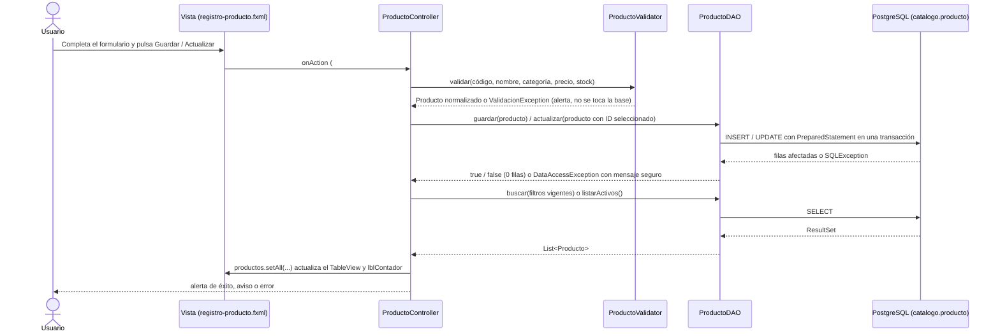

# Catálogo de productos – Papelería Campus

Aplicación de escritorio JavaFX que administra el catálogo de productos de una papelería
almacenado en PostgreSQL: listado, búsqueda con filtros, creación, actualización y eliminación,
con validaciones en la aplicación y en la base de datos.

## Versiones utilizadas

| Componente | Versión |
|---|---|
| JDK | 21 (Eclipse Temurin 21.0.12) |
| JavaFX (`javafx-controls`, `javafx-fxml`) | 21.0.6 |
| PostgreSQL (servidor) | 15.19 |
| Driver JDBC `org.postgresql:postgresql` | 42.7.4 |
| Maven (incluido como wrapper `mvnw`) | 3.8.5 |
| `maven-compiler-plugin` | 3.13.0 (release 21) |
| `javafx-maven-plugin` | 0.0.8 |
| `maven-surefire-plugin` | 3.5.4 |
| JUnit Jupiter (`api`, `params`, `engine`) | 5.12.1 |
| IDE / cliente SQL | IntelliJ IDEA, pgAdmin 4 |

## Dependencias

Todas se descargan automáticamente con Maven desde `pom.xml`; no hay que instalar nada a mano aparte del JDK y PostgreSQL.

- `org.openjfx:javafx-controls` y `org.openjfx:javafx-fxml`: interfaz gráfica.
- `org.postgresql:postgresql`: conexión JDBC a PostgreSQL.
- `org.junit.jupiter:*` (solo pruebas).

## Creación de la base de datos

El script está en [`src/main/java/com/appregistros/practicaevaluadacorte2/Database/papeleria_campus`](src/main/java/com/appregistros/practicaevaluadacorte2/Database/papeleria_campus).
Crea el esquema `catalogo`, la tabla `catalogo.producto` con sus restricciones y 12 productos de ejemplo.

```bash
createdb papeleria_campus
```

```bash
psql -d papeleria_campus -f src/main/java/com/appregistros/practicaevaluadacorte2/Database/papeleria_campus
```

También puede abrirse en pgAdmin (Query Tool) y ejecutarse completo.

> Los cinco `INSERT` del final del script son **pruebas de las restricciones CHECK** y deben fallar,
> cada uno con la restricción indicada en su comentario (`chk_codigo_normalizado`, `chk_nombre_longitud`,
> `chk_categoria`, `chk_precio`, `chk_stock`). Que fallen es el resultado esperado.

Restricciones de `catalogo.producto`:

| Columna | Regla |
|---|---|
| `id_producto` | `serial`, clave primaria |
| `codigo` | `varchar(10)`, obligatorio, único, en mayúsculas y sin espacios al inicio o final |
| `nombre` | `varchar(80)`, obligatorio, entre 1 y 80 caracteres sin espacios al inicio o final |
| `categoria` | `Papeleria`, `Tecnologia` o `Accesorios` |
| `precio` | `numeric(10,2)`, mayor que 0 |
| `stock` | entero mayor que 0 |

## Configuración

La conexión se define en [`DatabaseConnection.java`](src/main/java/com/appregistros/practicaevaluadacorte2/Database/DatabaseConnection.java)
y se toma de variables de entorno:

| Variable | Valor por defecto |
|---|---|
| `DB_URL` | `jdbc:postgresql://localhost:5432/papeleria_campus` |
| `DB_USER` | usuario local del autor |
| `DB_PASSWORD` | contraseña local del autor |

Defina sus propios valores antes de ejecutar (en IntelliJ: *Run > Edit Configurations > Environment variables*):

```bash
export DB_URL=jdbc:postgresql://localhost:5432/papeleria_campus DB_USER=postgres DB_PASSWORD=su_contraseña
```

Para comprobar solo la conexión, ejecute la clase `Database/dbTester.java`.

## Ejecución

```bash
./mvnw clean javafx:run
```

En Windows use `mvnw.cmd clean javafx:run`. Desde IntelliJ también puede ejecutarse la clase `Launcher` o `HelloApplication`.

Pruebas automatizadas (validaciones e integración del DAO):

```bash
./mvnw test
```

Las pruebas del DAO necesitan la base creada; si PostgreSQL no está disponible se omiten en lugar de fallar.
Solo crean productos con código `ZTEST*` y los eliminan al terminar. El detalle y los resultados están en [pruebas.md](pruebas.md).

## Estructura

```
src/main/java/com/appregistros/practicaevaluadacorte2/
├── HelloApplication.java / Launcher.java   arranque de JavaFX
├── controller/ProductoController.java      eventos de la vista, filtros, contador y alertas
├── validacion/ProductoValidator.java       reglas de validación del formulario
├── dao/ProductoDAO.java                    SQL con PreparedStatement y transacciones
├── dao/DataAccessException.java            error de acceso a datos con mensaje seguro
├── model/Producto.java                     modelo con propiedades JavaFX
└── Database/                               conexión, tester y script SQL
src/main/resources/.../registro-producto.fxml   vista
src/test/java/...                               pruebas JUnit
```

## Flujo interfaz > controlador > DAO > PostgreSQL > TableView



1. **Interfaz**: `registro-producto.fxml` declara el formulario, los filtros, el `TableView` y el contador. Cada botón llama a un método del controlador mediante `onAction`.
2. **Controlador**: `ProductoController` lee los campos, los valida con `ProductoValidator` y, si son correctos, llama al DAO. En Actualizar y Eliminar usa el ID de la fila seleccionada; Eliminar pide confirmación (Aceptar/Cancelar).
3. **DAO**: `ProductoDAO` ejecuta el SQL con `PreparedStatement`. Las escrituras se hacen en una transacción que solo se confirma si se afecta exactamente una fila; si no, se revierte y devuelve `false`. Toda `SQLException` se registra con la operación y el SQLState y se convierte en `DataAccessException` con un mensaje comprensible.
4. **PostgreSQL**: aplica las restricciones `UNIQUE` y `CHECK` como última barrera.
5. **Regreso al TableView**: tras cada operación el controlador vuelve a consultar la base con los filtros vigentes (los últimos aplicados con *Buscar*), reemplaza la lista observable del `TableView` y actualiza el contador. Si la consulta falla, la tabla se vacía y se muestra el error, nunca un listado desactualizado.

### Manejo de errores de base de datos

| SQLState | Causa | Mensaje mostrado |
|---|---|---|
| `08xxx` | No hay conexión con PostgreSQL | No se pudo conectar con la base de datos… |
| `23505` | Código duplicado | Ya existe otro producto con ese código. |
| `23514` | Violación de una restricción CHECK | Mensaje propio de cada restricción (precio, stock, categoría…) |
| `22001` | Texto más largo que la columna | Un texto supera la longitud permitida… |
| `22003` | Número fuera de rango | El precio o el stock está fuera del rango permitido. |
| `28P01`, `3D000`, `42P01` | Credenciales, base o tabla inexistente | Mensaje específico para cada caso |

El detalle técnico (SQL, restricción, pila) solo se escribe en el registro (`java.util.logging`), por ejemplo:

```
SEVERE: Operación=INSERT producto codigo=ZTEST2 | SQLState=23505 | código=0 | detalle=ERROR: duplicate key value violates unique constraint "producto_codigo_key"
```

## Observación conocida

El filtro *Existencias > Sin stock* busca `stock = 0`, pero la restricción `chk_stock` exige `stock > 0`,
así que ese filtro nunca devuelve filas. Si el enunciado admite productos agotados, la restricción debería ser `stock >= 0`
(y la validación del formulario, en consecuencia).

## Fuentes y herramientas de apoyo

- IntelliJ IDEA (desarrollo) y pgAdmin 4 (administración de la base y pruebas del script).
- Documentación oficial de OpenJFX, PostgreSQL (CREATE TABLE, restricciones CHECK y apéndice de códigos de error SQLState) y pgJDBC.
- Git y GitHub para el control de versiones.
- Claude Code (Anthropic), asistente de IA, utilizado para revisar el proyecto contra la rúbrica y para apoyar el manejo de excepciones por SQLState en el DAO, la clase de validación, el contador y la recarga con filtros, las pruebas JUnit y la redacción de este README y de `pruebas.md`. Los cambios se revisaron y probaron en el entorno local.
