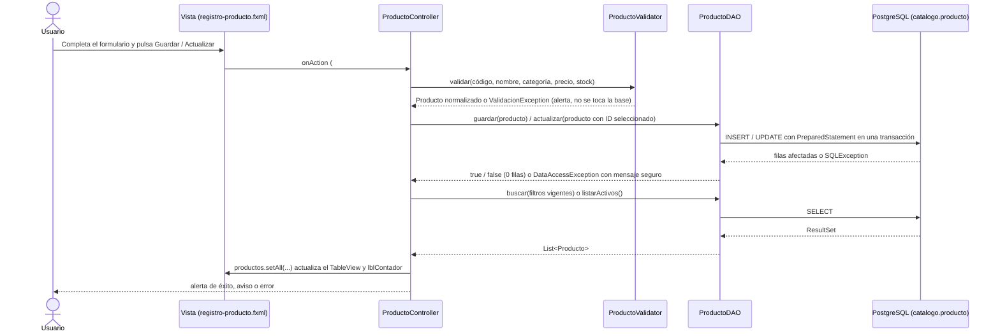

# Catálogo de productos – Papelería Campus

**Autor:** Andrés Mejía
**Trabajo:** Práctica evaluada – Corte 2
**Repositorio:** https://github.com/Andresmejia62/PracticaEvaluadaCorte2

Aplicación de escritorio JavaFX que administra el catálogo de productos de una papelería
almacenado en PostgreSQL: listado, búsqueda con filtros, creación, actualización y eliminación,
con validaciones en la aplicación y en la base de datos.

## Versiones utilizadas

| Componente | Versión |
|---|---|
| JDK | 21 (Eclipse Temurin 21.0.12) |
| JavaFX (`javafx-controls`, `javafx-fxml`) | 21.0.6 |
| PostgreSQL (servidor) | 15.19 |
| Driver JDBC `org.postgresql:postgresql` | 42.7.4 |
| Maven (incluido como wrapper `mvnw`) | 3.8.5 |
| `maven-compiler-plugin` | 3.13.0 (Java 21) |
| `javafx-maven-plugin` | 0.0.8 |
| `maven-surefire-plugin` | 3.5.4 |
| JUnit Jupiter (`api`, `params`, `engine`) | 5.12.1 |
| IDE / cliente SQL | IntelliJ IDEA, pgAdmin 4 |

## Dependencias

Todas se descargan automáticamente con Maven desde `pom.xml`; solo hay que tener instalados el JDK 21 y PostgreSQL.

- `org.openjfx:javafx-controls` y `org.openjfx:javafx-fxml`: interfaz gráfica.
- `org.postgresql:postgresql`: conexión JDBC a PostgreSQL.
- `org.junit.jupiter:junit-jupiter-api`, `-params` y `-engine`: pruebas automatizadas (solo en `test`).

## Creación de la base de datos

Los scripts están en la carpeta [`sql/`](sql):

| Archivo | Contenido |
|---|---|
| [`sql/estructura.sql`](sql/estructura.sql) | Esquema `catalogo` y tabla `catalogo.producto` con sus restricciones. Si la tabla ya existe, la elimina y la vuelve a crear vacía. |
| [`sql/datos.sql`](sql/datos.sql) | Carga de los 12 productos iniciales. Vacía la tabla y reinicia los IDs, por lo que también sirve para restaurar la base. |
| [`sql/pruebas_restricciones.sql`](sql/pruebas_restricciones.sql) | Opcional: cinco `INSERT` que **deben fallar**, uno por cada restricción CHECK. |

### 1. Crear y seleccionar la base `papeleria_campus`

Los scripts no crean la base: hay que crearla y conectarse a ella antes de ejecutarlos.

**Con psql:**

```sql
CREATE DATABASE papeleria_campus;
\c papeleria_campus
```

**Con pgAdmin 4:** clic derecho en *Databases > Create > Database…*, nombre `papeleria_campus`, *Save*.
Después seleccione `papeleria_campus` en el árbol y abra *Tools > Query Tool*. El Query Tool queda conectado a la base seleccionada.

### 2. Crear la estructura y cargar los datos

Conectado a `papeleria_campus`, ejecute los scripts en este orden. En psql (abierto desde la carpeta del proyecto):

```sql
\i sql/estructura.sql
\i sql/datos.sql
```

o desde la terminal, en la carpeta del proyecto:

```bash
psql -d papeleria_campus -f sql/estructura.sql
psql -d papeleria_campus -f sql/datos.sql
```

En pgAdmin: *File > Open* en el Query Tool, elegir cada archivo y ejecutarlo con *Execute (F5)*.

Para comprobar las restricciones (cada INSERT debe terminar con un error de la restricción indicada en su comentario):

```bash
psql -d papeleria_campus -f sql/pruebas_restricciones.sql
```

### Restaurar la base de prueba

Para volver al estado inicial (12 productos con IDs 1 a 12) después de hacer pruebas, ejecute de nuevo los datos:

```bash
psql -d papeleria_campus -f sql/datos.sql
```

Si también se modificó la estructura, ejecute primero `sql/estructura.sql` y luego `sql/datos.sql`.

### Restricciones de `catalogo.producto`

| Columna | Regla |
|---|---|
| `id_producto` | `serial`, clave primaria |
| `codigo` | `varchar(10)`, obligatorio, único, en mayúsculas y sin espacios al inicio o final |
| `nombre` | `varchar(80)`, obligatorio, entre 1 y 80 caracteres sin espacios al inicio o final |
| `categoria` | `Papeleria`, `Tecnologia` o `Accesorios` |
| `precio` | `numeric(10,2)`, mayor que 0 |
| `stock` | entero mayor que 0 |

## Configuración

La aplicación lee la conexión desde [`DatabaseConnection.java`](src/main/java/com/appregistros/practicaevaluadacorte2/Database/DatabaseConnection.java), en este orden de prioridad:

1. Variables de entorno `DB_URL`, `DB_USER` y `DB_PASSWORD`.
2. Archivo local `config/db.properties`.
3. Valores por defecto: `jdbc:postgresql://localhost:5432/papeleria_campus`, usuario `postgres`, sin contraseña.

El repositorio solo incluye el archivo de ejemplo [`config/db.properties.example`](config/db.properties.example), sin secretos.
La configuración real `config/db.properties` está excluida en `.gitignore`. Para configurar:

```bash
cp config/db.properties.example config/db.properties
```

y edite `config/db.properties` con su usuario y contraseña de PostgreSQL:

```properties
db.url=jdbc:postgresql://localhost:5432/papeleria_campus
db.user=su_usuario
db.password=su_contraseña
```

| Variable de entorno | Propiedad en `config/db.properties` | Descripción |
|---|---|---|
| `DB_URL` | `db.url` | URL JDBC de la base |
| `DB_USER` | `db.user` | Usuario de PostgreSQL |
| `DB_PASSWORD` | `db.password` | Contraseña de PostgreSQL |

La aplicación debe ejecutarse desde la carpeta del proyecto para encontrar `config/db.properties` (es lo que hacen Maven e IntelliJ por defecto).
Para comprobar solo la conexión, ejecute la clase `Database/dbTester.java`.

## Ejecución

```bash
./mvnw clean javafx:run
```

En Windows: `mvnw.cmd clean javafx:run`. Desde IntelliJ también puede ejecutarse la clase `Launcher` o `HelloApplication`.

Pruebas automatizadas (validaciones e integración del DAO):

```bash
./mvnw test
```

Las pruebas del DAO usan la base configurada; si PostgreSQL no está disponible se omiten en lugar de fallar.
Solo crean productos con código `ZTEST*` y los eliminan al terminar. Los resultados y las evidencias están en [pruebas.md](pruebas.md).

## Organización de clases

```
src/main/java/com/appregistros/practicaevaluadacorte2/
├── HelloApplication.java, Launcher.java
├── controller/ProductoController.java
├── validacion/ProductoValidator.java, ValidacionException.java
├── dao/ProductoDAO.java, DataAccessException.java
├── model/Producto.java
└── Database/DatabaseConnection.java, dbTester.java
src/main/resources/com/appregistros/practicaevaluadacorte2/registro-producto.fxml
src/test/java/.../validacion/ProductoValidatorTest.java
src/test/java/.../dao/ProductoDAOTest.java
sql/          scripts de la base de datos
config/       configuración de ejemplo
evidencias/   capturas y salidas de las pruebas
```

| Clase / archivo | Capa | Responsabilidad |
|---|---|---|
| `HelloApplication`, `Launcher` | Arranque | Cargan `registro-producto.fxml` y abren la ventana principal. |
| `registro-producto.fxml` | Vista | Formulario, filtros de búsqueda, `TableView` y contador de productos. |
| `ProductoController` | Controlador | Atiende los botones, aplica los filtros vigentes, actualiza el `TableView` y el contador, y muestra las alertas. |
| `ProductoValidator`, `ValidacionException` | Validación | Validan y normalizan los datos del formulario antes de enviarlos al DAO. |
| `ProductoDAO` | Acceso a datos | Consultas, búsqueda e INSERT/UPDATE/DELETE con `PreparedStatement` y transacciones. |
| `DataAccessException` | Acceso a datos | Error de base de datos con mensaje seguro para el usuario, SQLState y operación. |
| `Producto` | Modelo | Datos de un producto como propiedades JavaFX; lista de categorías permitidas. |
| `DatabaseConnection` | Configuración | Abre conexiones JDBC con la configuración externa. |
| `dbTester` | Utilidad | Prueba rápida de la conexión. |

## Flujo interfaz > controlador > DAO > PostgreSQL > TableView



1. **Interfaz**: `registro-producto.fxml` declara el formulario, los filtros, el `TableView` y el contador. Cada botón llama a un método del controlador mediante `onAction`.
2. **Controlador**: `ProductoController` lee los campos, los valida con `ProductoValidator` y, si son correctos, llama al DAO. En Actualizar y Eliminar usa el ID de la fila seleccionada; Eliminar pide confirmación (Aceptar/Cancelar).
3. **DAO**: `ProductoDAO` ejecuta el SQL con `PreparedStatement`. Las escrituras se hacen en una transacción que solo se confirma si se afecta exactamente una fila; si no, se revierte y devuelve `false`. Toda `SQLException` se registra con la operación y el SQLState y se convierte en `DataAccessException` con un mensaje comprensible.
4. **PostgreSQL**: aplica las restricciones `UNIQUE` y `CHECK` como última barrera.
5. **Regreso al TableView**: tras cada operación el controlador vuelve a consultar la base con los filtros vigentes (los últimos aplicados con *Buscar*), reemplaza la lista observable del `TableView` y actualiza el contador. Si la consulta falla, la tabla se vacía y se muestra el error, nunca un listado desactualizado.

### Manejo de errores de base de datos

| SQLState | Causa | Mensaje mostrado |
|---|---|---|
| `08xxx` | No hay conexión con PostgreSQL | No se pudo conectar con la base de datos… |
| `23505` | Código duplicado | Ya existe otro producto con ese código. |
| `23514` | Violación de una restricción CHECK | Mensaje propio de cada restricción (precio, stock, categoría…) |
| `22001` | Texto más largo que la columna | Un texto supera la longitud permitida… |
| `22003` | Número fuera de rango | El precio o el stock está fuera del rango permitido. |
| `28P01`, `3D000`, `42P01` | Credenciales, base o tabla inexistente | Mensaje específico para cada caso |

El detalle técnico (SQL, restricción, pila) solo se escribe en el registro (`java.util.logging`), por ejemplo:

```
SEVERE: Operación=INSERT producto codigo=ZTEST2 | SQLState=23505 | código=0 | detalle=ERROR: duplicate key value violates unique constraint "producto_codigo_key"
```

## Observación conocida

El filtro *Existencias > Sin stock* busca `stock = 0`, pero la restricción `chk_stock` exige `stock > 0`,
así que ese filtro nunca devuelve filas. Si el enunciado admite productos agotados, la restricción debería ser `stock >= 0`
(y la validación del formulario, en consecuencia).

## Fuentes y herramientas de apoyo

- IntelliJ IDEA (desarrollo) y pgAdmin 4 (administración de la base y pruebas de los scripts).
- Documentación oficial de OpenJFX, PostgreSQL (CREATE TABLE, restricciones CHECK y apéndice de códigos de error SQLState) y pgJDBC.
- Git y GitHub para el control de versiones.
- Claude Code (Anthropic), asistente de IA, utilizado para revisar el proyecto contra la rúbrica y para apoyar el manejo de excepciones por SQLState en el DAO, la clase de validación, el contador y la recarga con filtros, la configuración externa, la separación de los scripts SQL, las pruebas JUnit, la toma de evidencias y la redacción de este README y de `pruebas.md`. Los cambios se revisaron y probaron en el entorno local.
