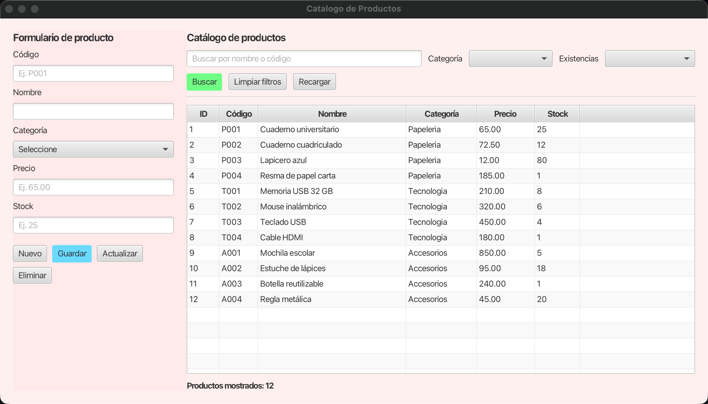
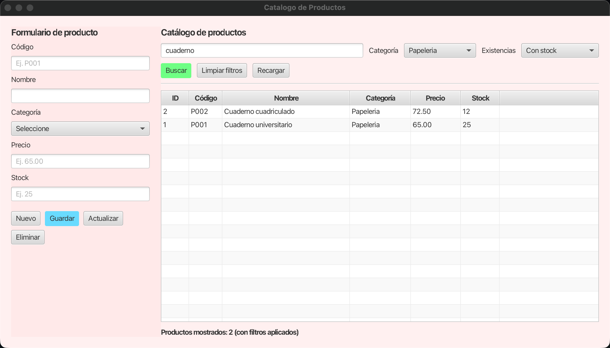
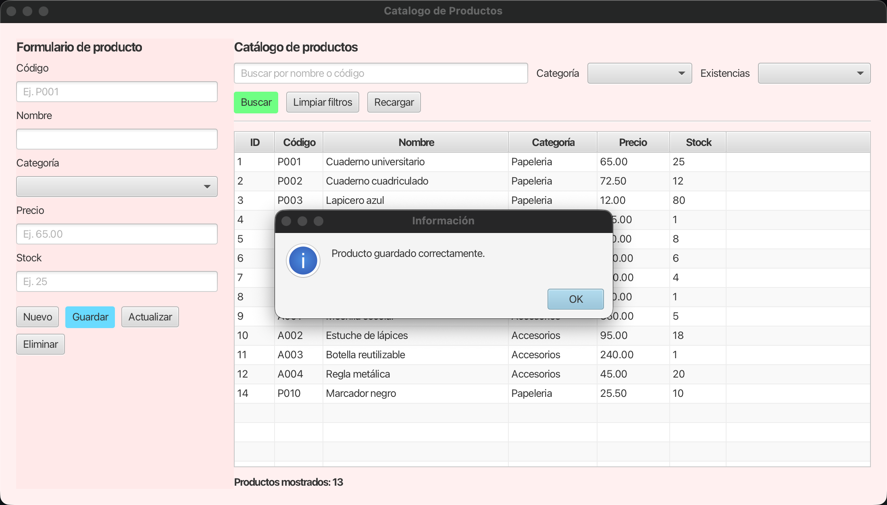
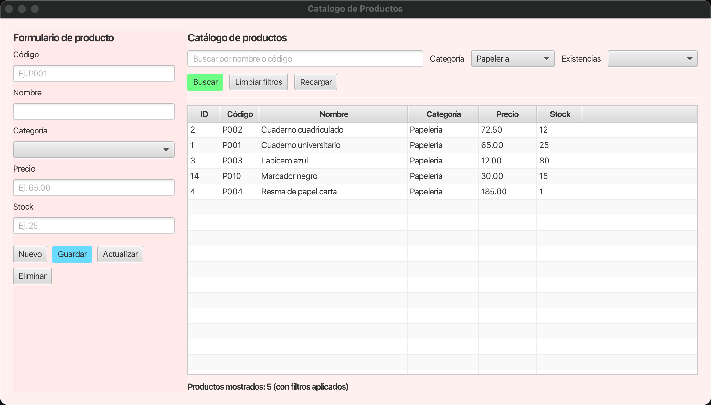
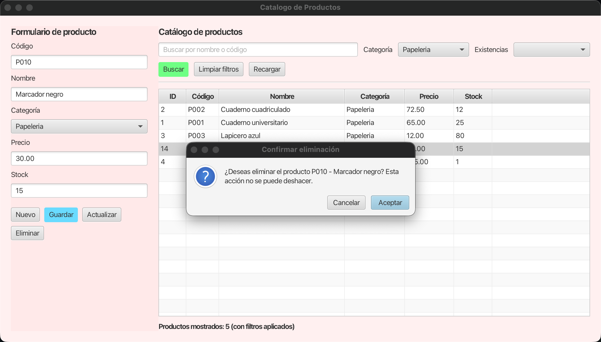
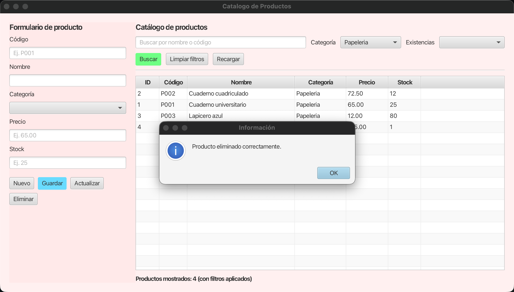
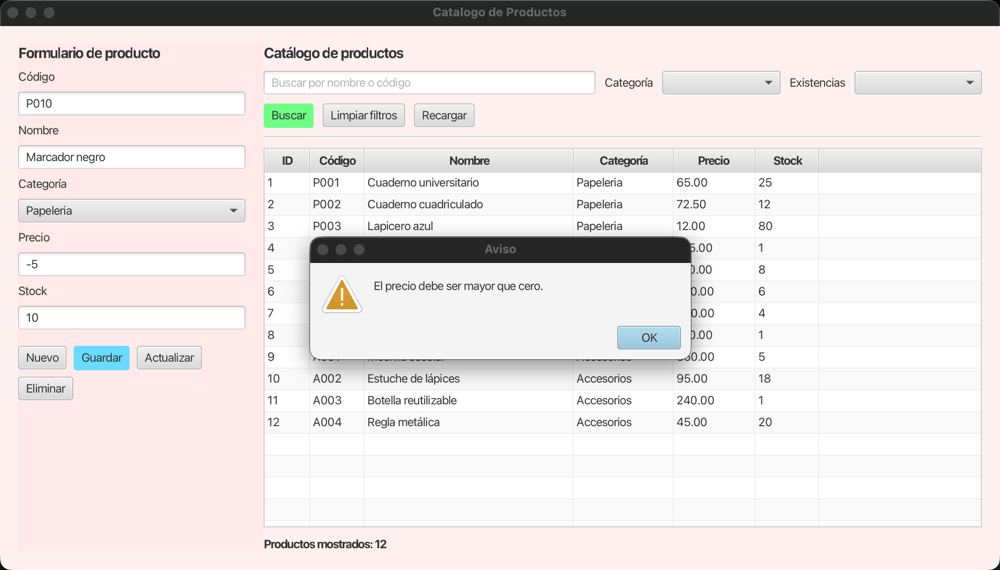
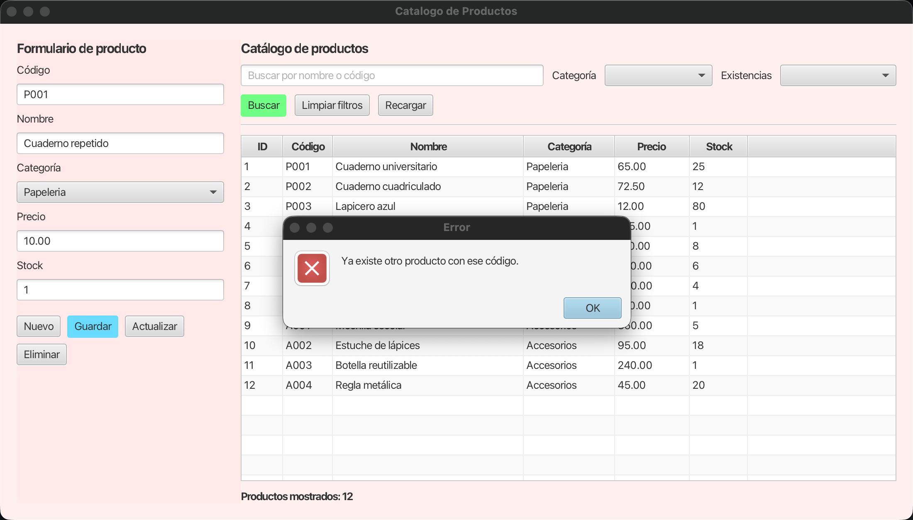

# Registro de pruebas

- **Fecha de ejecución:** 17/10/2026
- **Entorno:** macOS, JDK 21.0.12, JavaFX 21.0.6, PostgreSQL 15.19.
- **Base usada en las evidencias de la interfaz:** creada desde cero con `sql/estructura.sql` y `sql/datos.sql` (12 productos iniciales).
- **Pruebas automatizadas:** `./mvnw test` → **29 pruebas, 0 fallos, 0 errores, 0 omitidas** (`ProductoValidatorTest`: 24, `ProductoDAOTest`: 5).
- **Leyenda:** ✅ pasa · ❌ falla · ⚠️ observación.

> Los casos B1–B7, V1–V10 y E1–E4 se numeraron siguiendo la rúbrica. Si la descripción de algún caso
> en la página 4 del enunciado es distinta, ajustar la columna *Caso* manteniendo los resultados registrados.

## Matriz de resultados

| Grupo | Casos | Resultado | Evidencia principal |
|---|---|---|---|
| Listado inicial | 1 | ✅ | [01_listado_inicial.png](evidencias/01_listado_inicial.png) |
| B1–B7 búsquedas | 7 | 7/7 ✅ (⚠️ en B5) | [02_filtro_combinado.png](evidencias/02_filtro_combinado.png) |
| Ciclo CRUD | 7 pasos | ✅ | capturas 05–11 y [ciclo_crud_consultas_bd.txt](evidencias/ciclo_crud_consultas_bd.txt) |
| V1–V10 validaciones | 10 | 10/10 ✅ | [03_validacion_precio.png](evidencias/03_validacion_precio.png), [04_validacion_codigo_duplicado.png](evidencias/04_validacion_codigo_duplicado.png) |
| E1–E4 excepciones | 4 | 4/4 ✅ | salidas del registro (abajo) |
| Restricciones CHECK (SQL) | 5 | 5/5 ✅ | salida de `sql/pruebas_restricciones.sql` |
| Pruebas fallidas registradas | 7 | 6 corregidas, 1 abierta | sección final |

## Listado inicial

Al abrir la aplicación sobre la base recién creada se muestran los 12 productos y el contador "Productos mostrados: 12". ✅



## Búsquedas (B1–B7)

Ejecutadas con `ProductoDAO.buscar(texto, categoría, existencias)`, que es lo que invoca el botón **Buscar**.

| ID | Caso | Entrada | Esperado | Obtenido | Resultado |
|---|---|---|---|---|---|
| B1 | Texto parcial en el nombre | `cuaderno` | P001, P002 | 2 filas: P002, P001 | ✅ |
| B2 | Texto parcial en el código | `t00` | T001–T004 | 4 filas: T004, T001, T002, T003 | ✅ |
| B3 | Sin distinguir mayúsculas | `LAPICERO` | P003 | 1 fila: P003 | ✅ |
| B4 | Filtro por categoría | Categoría `Tecnologia` | 4 productos de tecnología | 4 filas: T001–T004 | ✅ |
| B5 | Filtro por existencias | `Con stock` / `Sin stock` | todos / 0 | todos / 0 filas | ✅ ⚠️ |
| B6 | Filtros combinados | `cuaderno` + `Papeleria` + `Con stock`; `cuaderno` + `Tecnologia` | 2 / 0 | 2 filas (P001, P002) / 0 filas | ✅ |
| B7 | Sin resultados | `zzz` | 0 filas y aviso "Sin resultados para la búsqueda." | 0 filas | ✅ |

Prueba adicional: el texto `' OR '1'='1` devuelve 0 filas; la búsqueda usa parámetros de `PreparedStatement` y no es vulnerable a inyección SQL. ✅

⚠️ B5: *Sin stock* nunca puede devolver filas porque `chk_stock` exige `stock > 0` (ver F7).

Filtro combinado en la interfaz (B6): texto `cuaderno`, categoría `Papeleria` y existencias `Con stock`; 2 resultados y el contador indica que hay filtros aplicados.



## Ciclo CRUD

Realizado en la interfaz con el producto `P010 – Marcador negro`. Después de cada paso se consultó PostgreSQL ([ciclo_crud_consultas_bd.txt](evidencias/ciclo_crud_consultas_bd.txt)).
También está automatizado en `ProductoDAOTest.cicloCrud` (✅), que además comprueba que el UPDATE y el DELETE no modifican ninguna otra fila.

| Paso | Acción | Resultado en la interfaz | Estado en PostgreSQL | Resultado | Evidencia |
|---|---|---|---|---|---|
| Crear | `P010`, "Marcador negro", Papeleria, 25.50, 10 → **Guardar** | "Producto guardado correctamente."; la fila aparece y el contador pasa de 12 a 13 sin reiniciar | Fila `14 \| P010 \| Marcador negro \| Papeleria \| 25.50 \| 10` | ✅ | [05](evidencias/05_crud_crear.png) |
| Actualizar | Filtro categoría `Papeleria` → Buscar; seleccionar P010; precio 30.00 y stock 15 → **Actualizar** | "Producto actualizado correctamente."; la tabla sigue filtrada (5 productos de Papeleria, "con filtros aplicados") y muestra los valores nuevos | Misma fila (ID 14) con `30.00 \| 15`; las demás sin cambios | ✅ | [06](evidencias/06_crud_actualizar_edicion.png), [07](evidencias/07_crud_actualizar_mensaje.png), [08](evidencias/08_crud_actualizar_resultado.png) |
| Eliminar – confirmación | Seleccionar P010 → **Eliminar** | Diálogo "Confirmar eliminación" con Aceptar y Cancelar | — | ✅ | [09](evidencias/09_crud_eliminar_confirmacion.png) |
| Eliminar – Cancelar | **Cancelar** | El registro sigue en la tabla | La fila ID 14 sigue existiendo | ✅ | [10](evidencias/10_crud_eliminar_cancelado.png) |
| Eliminar – Aceptar | **Eliminar** → **Aceptar** | "Producto eliminado correctamente."; solo desaparece P010 y el contador baja de 5 a 4 (filtro vigente) | 12 productos, ninguno con código P010 | ✅ | [11](evidencias/11_crud_eliminar_aceptado.png) |






## Validaciones (V1–V10)

Se aplican igual al **insertar** y al **actualizar** con `ProductoValidator`; si una regla falla se muestra el mensaje
y no se envía nada a PostgreSQL. V10 aplica a **actualizar** y **eliminar**.

| ID | Caso | Entrada de ejemplo | Mensaje obtenido | Prueba | Resultado |
|---|---|---|---|---|---|
| V1 | Campos obligatorios vacíos o solo espacios | código vacío, nombre `"   "`, sin categoría… | "Completa los campos obligatorios: código." | `camposObligatorios` | ✅ |
| V2 | Código se normaliza | `"  p010 "` | Se guarda como `P010` | `datosValidosSeNormalizan` | ✅ |
| V3 | Código: longitud y caracteres | `ABCDEFGHIJK`, `P 01`, `P#01` | "El código no puede tener más de 10 caracteres." / "…solo puede contener letras, números y guiones, sin espacios." | `codigo` | ✅ |
| V4 | Código duplicado | `P001` ya existente | "Ya existe otro producto con ese código." (no se inserta) | `ProductoDAOTest.codigoDuplicado`, captura [04](evidencias/04_validacion_codigo_duplicado.png) | ✅ |
| V5 | Nombre de 1 a 80 caracteres | 81 caracteres | "El nombre no puede tener más de 80 caracteres." | `nombre` | ✅ |
| V6 | Categoría fuera de la lista | `Muebles`, `Papelería`, `papeleria` | "Selecciona una categoría válida: Papeleria, Tecnologia, Accesorios." | `categoriaInvalida` | ✅ |
| V7 | Precio no numérico | `abc`, `12a`, `1e3`, `$10` | "El precio debe ser un número válido, por ejemplo 65.00." | `precioNoNumerico` | ✅ |
| V8 | Precio cero, negativo, más de 2 decimales o fuera de rango | `0`, `-5`, `10.999`, `100000000` | "El precio debe ser mayor que cero." / "…como máximo 2 decimales." / "…no puede ser mayor que 99999999.99." | `precioNoPositivo`, `precioDecimalesYRango`, captura [03](evidencias/03_validacion_precio.png) | ✅ |
| V9 | Stock no entero, cero o negativo | `5.5`, `abc`, `0`, `-1`, `99999999999` | "El stock debe ser un número entero, sin decimales." / "…mayor que cero." / "…fuera del rango permitido." | `stockNoEntero`, `stockNoPositivo`, `stockFueraDeRango` | ✅ |
| V10 | Actualizar o eliminar sin selección o sobre un registro que ya no existe | Sin fila seleccionada; ID ya eliminado | "Selecciona un producto de la tabla para actualizar/eliminar." / "…el registro seleccionado ya no existe. Se recargó la tabla." | `ProductoDAOTest.filasAfectadasCero` y revisión del controlador | ✅ |

Validación en la interfaz (V8): precio `-5`. Se muestra el aviso, el formulario conserva los datos y la tabla no cambia (12 productos).



Código duplicado (V4): PostgreSQL rechaza el INSERT por la restricción `UNIQUE`; el DAO lo traduce a un mensaje claro y la tabla no cambia.



## Excepciones y consistencia (E1–E4)

| ID | Caso | Procedimiento | Obtenido | Resultado |
|---|---|---|---|---|
| E1 | Fallo de conexión | `DB_URL=jdbc:postgresql://localhost:5999/papeleria_campus` (puerto sin servidor) y consulta del listado | Mensaje: "No se pudo conectar con la base de datos. Verifique que PostgreSQL esté en ejecución." La aplicación no se cierra, la tabla queda vacía y el contador indica "No se pudieron cargar los productos." | ✅ |
| E2 | Unicidad y CHECK gestionados en el DAO | `codigoDuplicado`, `violacionCheck` (precio 0 al insertar, stock -1 al actualizar) y captura 04 | SQLState 23505 y 23514 traducidos a mensajes propios; la fila duplicada no se inserta y la fila actualizada conserva `stock = 5` (transacción revertida) | ✅ |
| E3 | Filas afectadas en UPDATE y DELETE | `filasAfectadasCero`: UPDATE y DELETE sobre un ID ya eliminado | Ambos devuelven `false`; la interfaz muestra un aviso en lugar de éxito y recarga la tabla | ✅ |
| E4 | Registro de SQLState + operación y mensaje seguro | `mensajeSeguro` y salida del registro | El mensaje no contiene "duplicate", nombres de restricciones ni del esquema; la causa original se conserva | ✅ |

Salida real del registro durante las pruebas:

```
SEVERE: Operación=SELECT productos activos | SQLState=08001 | código=0 | detalle=Connection to localhost:5999 refused. ...
SEVERE: Operación=INSERT producto codigo=P001 | SQLState=23505 | código=0 | detalle=ERROR: duplicate key value violates unique constraint "producto_codigo_key"
SEVERE: Operación=INSERT producto codigo=ZTEST3 | SQLState=23514 | código=0 | detalle=ERROR: new row for relation "producto" violates check constraint "chk_precio"
SEVERE: Operación=UPDATE producto id=42 | SQLState=23514 | código=0 | detalle=ERROR: new row for relation "producto" violates check constraint "chk_stock"
WARNING: Operación=UPDATE producto id=37 | filas afectadas=0 | cambio revertido
WARNING: Operación=DELETE producto id=37 | filas afectadas=0 | cambio revertido
```

## Restricciones CHECK en PostgreSQL

`sql/estructura.sql`, `sql/datos.sql` y `sql/pruebas_restricciones.sql` ejecutados con `psql` en una base vacía: cada INSERT de prueba falla con la restricción esperada.

```
CREATE SCHEMA
CREATE TABLE
INSERT 0 12
ERROR:  new row for relation "producto" violates check constraint "chk_codigo_normalizado"
ERROR:  new row for relation "producto" violates check constraint "chk_nombre_longitud"
ERROR:  new row for relation "producto" violates check constraint "chk_categoria"
ERROR:  new row for relation "producto" violates check constraint "chk_precio"
ERROR:  new row for relation "producto" violates check constraint "chk_stock"
```

Restauración: después de insertar un producto extra, ejecutar de nuevo `sql/datos.sql` deja la tabla con 12 productos e IDs 1 a 12. ✅

## Pruebas fallidas registradas

| ID | Prueba | Falla detectada | Estado |
|---|---|---|---|
| F1 | Compilar desde GitHub | El repositorio no incluía `ProductoDAO.java`; el proyecto clonado no compilaba | Corregido (commit `1508c02`) |
| F2 | Pruebas CHECK del script | Los cinco INSERT usaban `'Papelería'` con tilde y todos fallaban por `chk_categoria` en lugar de la restricción que se quería probar ([evidencia](evidencias/F2_checks_antes_de_corregir.png)); además faltaban `;` tras `create schema` y `create table` | Corregido en `sql/` |
| F3 | Crear / Eliminar: contador | `lblContador` existía en el FXML pero no estaba enlazado ni se actualizaba | Corregido en `ProductoController` |
| F4 | Actualizar respeta filtros | Tras actualizar se recargaba la tabla completa ignorando los filtros aplicados | Corregido en `ProductoController` |
| F5 | Validaciones al actualizar | Actualizar no validaba precio ni stock mayores que cero, ni longitudes; el error llegaba como texto crudo de PostgreSQL | Corregido con `ProductoValidator` |
| F6 | E2 / E4 | Se mostraba `ex.getMessage()` de PostgreSQL al usuario y no se registraba el SQLState ni la operación | Corregido en `ProductoDAO` |
| F7 | B5 *Sin stock* | Siempre 0 filas porque `chk_stock` exige `stock > 0` | ⚠️ Abierta: depende de si el enunciado admite stock 0 (cambiar a `stock >= 0`) |

## Archivos de evidencia

| Archivo | Contenido |
|---|---|
| `evidencias/01_listado_inicial.png` | Listado inicial con 12 productos y contador |
| `evidencias/02_filtro_combinado.png` | Texto + categoría + existencias |
| `evidencias/03_validacion_precio.png` | Validación de precio negativo |
| `evidencias/04_validacion_codigo_duplicado.png` | Código duplicado rechazado |
| `evidencias/05_crud_crear.png` | Crear |
| `evidencias/06_crud_actualizar_edicion.png` | Actualizar: producto seleccionado con filtro vigente y datos editados |
| `evidencias/07_crud_actualizar_mensaje.png` | Actualizar: mensaje de éxito |
| `evidencias/08_crud_actualizar_resultado.png` | Actualizar: tabla recargada con el filtro vigente |
| `evidencias/09_crud_eliminar_confirmacion.png` | Eliminar: confirmación |
| `evidencias/10_crud_eliminar_cancelado.png` | Eliminar: Cancelar conserva el registro |
| `evidencias/11_crud_eliminar_aceptado.png` | Eliminar: Aceptar elimina y actualiza tabla y contador |
| `evidencias/ciclo_crud_consultas_bd.txt` | Consultas a PostgreSQL después de cada paso del CRUD |
| `evidencias/F2_checks_antes_de_corregir.png` | Ejecución original de las pruebas CHECK (falla F2) |
